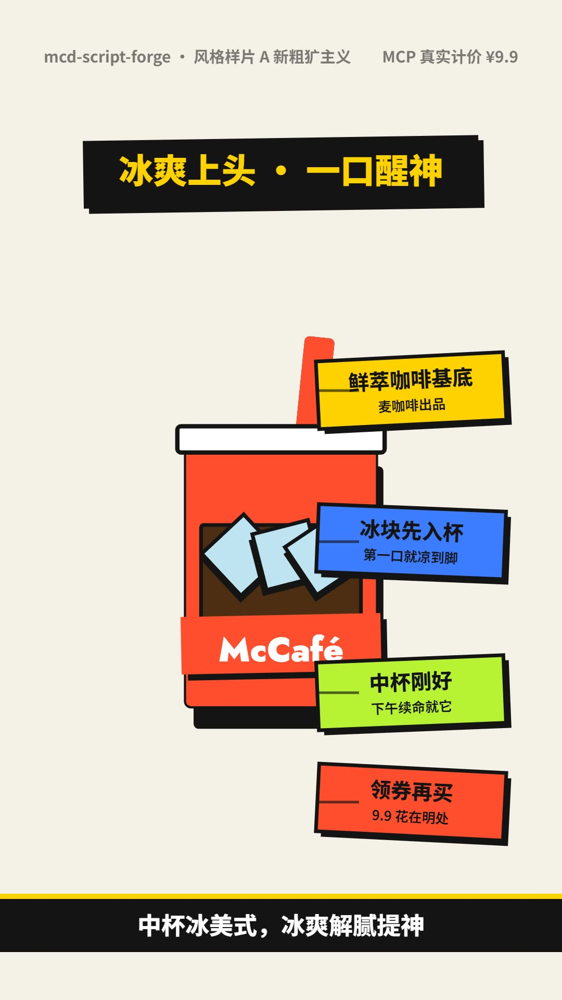
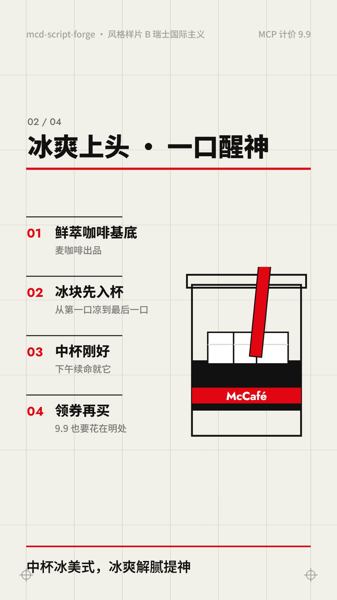

# 🍔🎤 麦门口播脚本工坊 (mcd-script-forge)

> **2026 麦当劳程序员创意开发大赛 · 参赛作品** ｜ 基于 [麦当劳中国官方 MCP](https://open.mcd.cn/mcp) 开发 ｜ 🤖 全程使用 [WorkBuddy](https://www.workbuddy.cn) 辅助开发

一句话：**给它一个主推单品（或预算/场景），它拉取麦当劳 MCP 的真实菜单、券池、活动数据，自动产出一条可直接开拍的短视频口播脚本 + 分镜表 + SRT 字幕。**

麦当劳 MCP 把菜单、优惠券、计价、活动日历都开放成了原子接口，但对短视频创作者来说，"数据"不能直接"开拍"——中间差的是**话术结构**：前 2 秒钩子怎么说、价格锚点怎么砸、行动号召怎么落。本作品把这条"从数据到成片脚本"的链路产品化。

## ✨ 它能做什么

| 模式 | 你说 | 它做 |
|---|---|---|
| 🎬 一句话出脚本 | "给板烧鸡腿堡出条 15s 抖音口播" | 拉 MCP 菜单 + 券池 + 计价 → 生成口播全文（钩子/卖点/价格锚点/CTA 四段结构）|
| 📋 分镜同步产出 | — | 同步输出分镜表 CSV（镜号/时长/画面建议/口播/字幕），拿来就能进剪辑软件 |
| 💬 字幕直接可拍 | — | 输出 SRT 字幕文件，时间轴按节拍切好，剪映/PR 直接导入 |
| 💰 价格锚点自动化 | — | 原价 vs 券后价 vs 立省金额，全部来自 MCP 真实计价，不是编的 |
| 🎨 画面风格建议 | — | 每个分镜给出 MG 风格画面建议（扁平矢量/等轴 2.5D 等成熟风格库）|

## 🚀 快速开始

### 方式一：Demo 模式（无需 Token，一条命令）

```bash
python mcd_script_forge.py --demo --product "板烧鸡腿堡" --duration 15 --platform 抖音
```

输出三件套到 `examples/`：`script.md`（口播脚本）、`storyboard.csv`（分镜表）、`captions.srt`（字幕）。

### 方式二：接入真实麦当劳 MCP（完整体验）

1. 前往 https://open.mcd.cn/mcp → 手机号登录 → 控制台 → 激活 → 复制 Token
2. 在 WorkBuddy 中配置麦当劳 MCP 连接器（详见 [MCP_INTEGRATION.md](MCP_INTEGRATION.md)）
3. 对 WorkBuddy 说："**给板烧鸡腿堡出一条 15 秒抖音口播脚本，要真数据**"
4. WorkBuddy 会拉取真实菜单/券/计价数据存为 `mcp-data.json`，再调用本工具生成脚本

#### 获取你自己的 Token

- MCP Token 是**每人独立**的，跟随你自己的麦当劳账号（本仓库不含任何 Token，作者也无法分享自己的）。
- 命令行直接调用 `mcp_client.py` 时，通过环境变量传入，Token 不进代码不进 Git：

  ```bash
  # PowerShell
  $env:MCD_MCP_TOKEN = "你的Token"
  # Git Bash / Linux / macOS
  export MCD_MCP_TOKEN="你的Token"
  ```

- ⚠️ Token 等同于你账号的券池访问凭证：**不要提交到 Git、不要发给别人**。如果不小心泄漏，回 open.mcd.cn 控制台重置即可。

### 方式三：在 WorkBuddy 中加载为 Skill（推荐，可参与专项奖励）

把本仓库的 `SKILL.md` 放入 WorkBuddy 技能目录即可。加载后自然语言触发："麦门脚本 / 出条卖货口播 / 麦麦帮我写条推广"。

## 📦 输出示例

见 [examples/](examples/) 目录（demo 模式真实产出）：

- `script.md` — 带 0.0s 精确时间轴的口播全文 + 拍摄提示
- `storyboard.csv` — 分镜表（可直接进剪映/PR 排期）
- `captions.srt` — SRT 字幕（可直接导入）

## 🏗 项目结构

```
mcd-script-forge/
├── mcd_script_forge.py     # 主工具（纯 Python 标准库，零依赖）
├── SKILL.md                # WorkBuddy Skill 定义
├── MCP_INTEGRATION.md      # 麦当劳 MCP 接入文档（含调用流程图）
├── CONTEST_DECLARATION.md  # 参赛声明
├── workbuddy.md            # WorkBuddy 辅助开发过程记录（专项奖励依据）
├── prompts/PROMPT-v1.md    # 原创风格提示词契约（新粗犷主义/瑞士国际主义）
├── samples/                # 风格样片（mp4，见上文播放链接）
├── examples/               # demo 模式产出示例
└── README.md
```

## 🧩 设计理念

1. **数据不说谎**：所有价格、券后价、立省金额来自 MCP `calculate-price` 真实试算，杜绝"虚假促销"话术风险；
2. **结构即生产力**：短视频口播有成熟的时间轴结构（0-2s 钩子 → 卖点 → 价格锚点 → CTA），模板化后创作效率提升一个量级；
3. **贴近创作者真实工作流**：脚本 + 分镜 + 字幕三件套一次出齐，才是剪辑师真正要的东西；
4. **确定可复现**：同一份输入永远产出同一份脚本（种子化随机），方便迭代对比。

## 📄 许可与声明

- 代码：MIT License
- 本项目为 2026 麦当劳程序员创意开发大赛参赛作品，参赛声明见 [CONTEST_DECLARATION.md](CONTEST_DECLARATION.md)
- 麦当劳、金拱门及相关商标为麦当劳公司所有，本项目仅在大赛授权范围内通过官方 MCP 接口使用其数据

## 🎬 风格样片（2026-10-11）

两条样片基于**同一份 MCP 真实计价数据**（麦咖啡™冰美式中杯 · 深圳龙华和平东路店：原价 19 → 券后 **9.9**，立省 9.1），分别以 [prompts/PROMPT-v1.md](prompts/PROMPT-v1.md) 风格契约中的两种风格渲染。

| 新粗犷主义 Neo-Brutalism | 瑞士国际主义 Swiss International |
|:---:|:---:|
| [](https://hubbil-154.github.io/mcd-script-forge/) | [](https://hubbil-154.github.io/mcd-script-forge/) |
| 硬偏移阴影 / 粗黑描边 / 砸感入场 | 严格网格 / 超大字号 / 零过冲动效 |

**▶ 点击封面到 [Web 画廊](https://hubbil-154.github.io/mcd-script-forge/)播放**（带声音）；也可直接观看文件：[style-nb.mp4](samples/style-nb.mp4) / [style-sw.mp4](samples/style-sw.mp4)。

规格统一：1080×1920 竖版 / 15s / 30fps / h264+aac / −14 LUFS 母带。

技术链路：`mcp_client.py`（纯标准库 MCP 客户端）→ `calculate-price` 真实计价 → 脚本三件套 → `film-nb.html` / `film-swiss.html` Canvas 2D 确定性渲染 → 成片。

## 致谢与风格来源（Credits）

本项目的视频风格审美在早期探索阶段参考了开源项目 **[mg-styles-15](https://github.com/Vincentwei1021/mg-styles-15)**（MG 动态设计风格提示词库，MIT License），特此致谢（Inspired by）：

- 上文的风格样片基于本项目**原创**的 [prompts/PROMPT-v1.md](prompts/PROMPT-v1.md) 风格契约（新粗犷主义 / 瑞士国际主义），为原创框架与原创措辞，非该库提示词的直接产物；
- 所有渲染代码（Canvas 2D 工程页、渲染管线、音频合成）为本项目原创实现，未复制该库的任何代码或素材。
